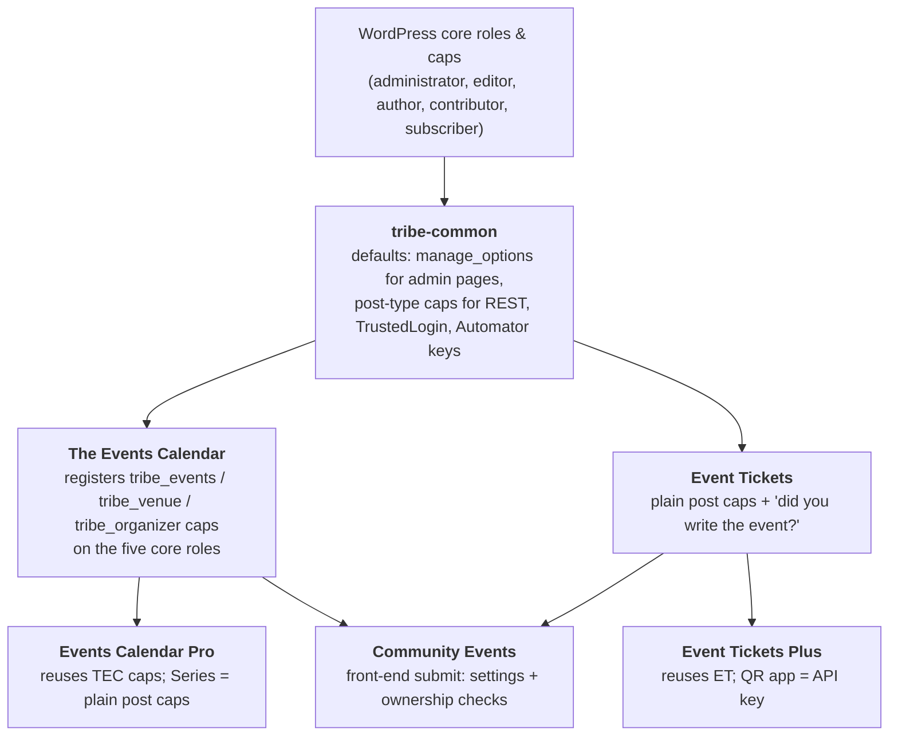
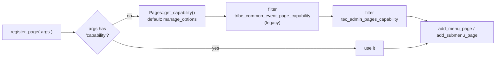
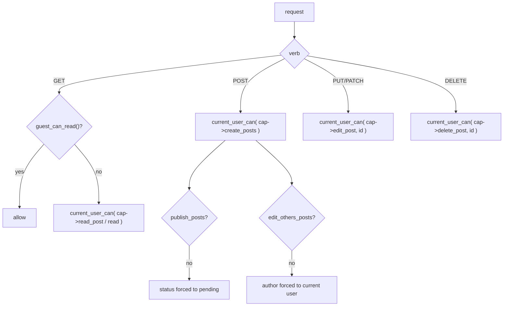
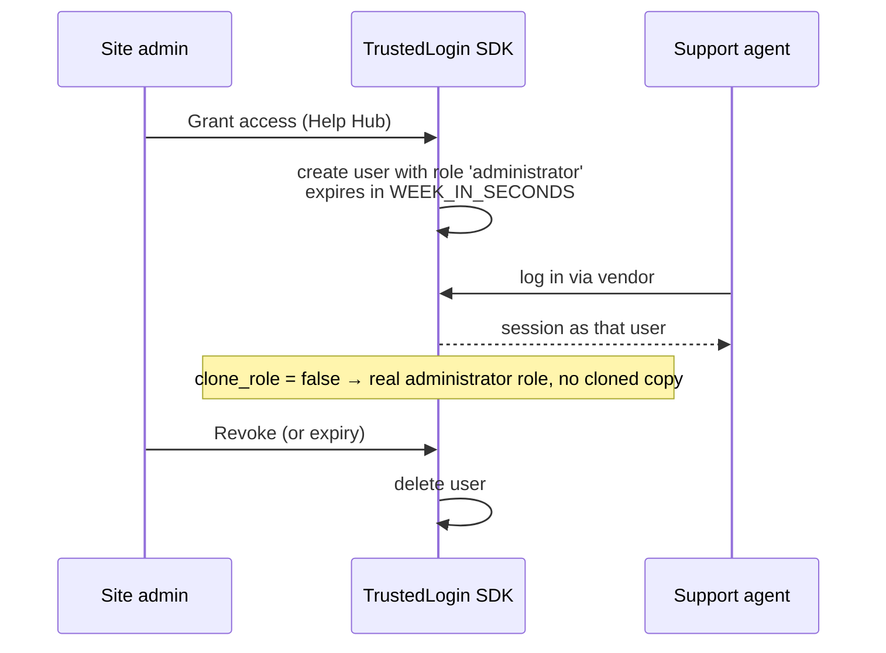

# RBAC in Tribe Common

> **TL;DR**
>
> - Common defines **no roles** and grants **no capabilities**. It only *checks* them.
> - It sets the **defaults the whole suite inherits**: admin pages need `manage_options`, the new REST API uses the post type's own caps, guests can't read REST entities unless an endpoint says so.
> - **TrustedLogin** creates a temporary `administrator` for support. It lives one week by default.
> - **Event Automator** (Zapier, Power Automate) uses API keys, not roles. The key is tied to a user who must be able to edit events.
> - You change behaviour with **filters** (see [How to change it](#how-to-change-it)), never by editing roles.

This page is the **suite overview** too. Each plugin has its own `docs/RBAC/README.md`; they all link back here.

---

## How to read this page

- **Support / QA**: read [Who can do what](#who-can-do-what) and [Gotchas](#gotchas). Stop there.
- **Engineers**: continue to [How it works](#how-it-works), [Where it lives in code](#where-it-lives-in-code) and [How to change it](#how-to-change-it).
- Each section stands on its own. Skipping is fine.

---

## The suite at a glance

Capabilities flow **down** the stack. A plugin lower in the diagram only ever *reuses* what sits above it.

| Plugin | Defines caps? | Main idea | Doc |
|---|---|---|---|
| tribe-common | No | Defaults + filters | this page |
| The Events Calendar | **Yes** | Custom `tribe_events` caps granted to core roles | `the-events-calendar/docs/RBAC` |
| Event Tickets | No | Standard post caps, plus event authorship | `event-tickets/docs/RBAC` |
| Events Calendar Pro | No | Reuses TEC caps | `events-pro/docs/RBAC` |
| Event Tickets Plus | No | Reuses ET; API key for the QR app | `event-tickets-plus/docs/RBAC` |
| Community Events | No | Settings + "is this your post?" | `events-community/docs/RBAC` |

---

## Who can do what

Default WordPress roles, nothing customised. ✅ = can, ❌ = cannot.

| Feature in Common | Capability checked | Admin | Editor | Author | Contributor | Subscriber | Logged-out |
|---|---|---|---|---|---|---|---|
| Events › Settings pages (save & view) | `manage_options` | ✅ | ❌ | ❌ | ❌ | ❌ | ❌ |
| Help Hub | `manage_options` | ✅ | ❌ | ❌ | ❌ | ❌ | ❌ |
| Troubleshooting page | `install_plugins` | ✅ | ❌ | ❌ | ❌ | ❌ | ❌ |
| Event Add-Ons (App Shop) | `install_plugins` | ✅ | ❌ | ❌ | ❌ | ❌ | ❌ |
| Licenses tab | `activate_plugins` | ✅ | ❌ | ❌ | ❌ | ❌ | ❌ |
| Onboarding wizard (REST) | `manage_options` | ✅ | ❌ | ❌ | ❌ | ❌ | ❌ |
| Customizer sections | `edit_theme_options` | ✅ | ❌ | ❌ | ❌ | ❌ | ❌ |
| In-app notifications icon | `manage_options` | ✅ | ❌ | ❌ | ❌ | ❌ | ❌ |
| Upsell / conditional content | `manage_options` | ✅ | ❌ | ❌ | ❌ | ❌ | ❌ |
| Zapier / Power Automate admin | `manage_options` | ✅ | ❌ | ❌ | ❌ | ❌ | ❌ |
| Zapier / Power Automate REST | API key + key owner can `edit_tribe_events` | key | key | key | ❌ | ❌ | ❌ |
| Grant support access (TrustedLogin) | SDK decides (admin UI) | ✅ | ❌ | ❌ | ❌ | ❌ | ❌ |
| New REST API (`tec/v1`) read | post type `read` / `read_post` | ✅ | ✅ | ✅ | ✅ | ✅ | ❌ |
| New REST API (`tec/v1`) write | post type `edit_*` / `delete_*` | ✅ | ✅ | own | own | ❌ | ❌ |
| Public system info endpoint | secret key in URL | key | key | key | key | key | key |

**Multisite**: PUE license fields check `is_super_admin()` and `is_network_admin()` instead.

> ⚠️ "Logged-out ❌" on the new REST API is the **default** (`guest_can_read()` is `false`). Plugins override it per endpoint. Event Tickets, for example, makes ticket reads public.

---

## How it works

### 1. Admin pages: one default, two filters

Every admin page the suite registers through `Tribe\Admin\Pages` gets its capability from one method. Change it once, every page follows.

- Saving settings re-checks the same `Pages::get_capability()`.
- The older `tribe_settings_req_cap` filter still exists but is only read by the activation redirect. Don't rely on it.
- Pages built on `Abstract_Admin_Page` use `required_capability()` instead. It returns `manage_options` and has **no filter**; subclasses override the method.

### 2. New REST API (`tec/v1`): the post type decides

`Post_Entity_Endpoint` maps each HTTP verb to the entity's post type caps. There is no separate REST permission layer.

- `Custom_Entity_Endpoint` (non-post entities) uses one cap for everything: `get_minimum_capability()` → `manage_options`. Override the method.
- `/docs` (OpenAPI) is public.
- Legacy `tribe_register_rest_route()` defaults `permission_callback` to `__return_true` when none is given. **Always pass one.**

### 3. TrustedLogin: a temporary admin for support

All three knobs are filterable: role, lifetime, clone-role. See the table below.

### 4. Event Automator: keys, not roles

1. Site admin (`manage_options`) creates an API key in the Zapier / Power Automate tab and **picks a user** for it. The dropdown lists Administrators and Editors.
2. Zapier calls REST with the key. `permission_callback` is `__return_true`; the key is verified **inside** the handler.
3. On `rest_pre_dispatch`, Common checks `user_can( key_user, edit_tribe_events )`. If that passes it runs `wp_set_current_user( key_user )`.
4. From there, normal WordPress caps apply as that user.

> The key's stored `permissions` field (`read` by default) is only checked for being non-empty. Don't treat it as a permission level.

---

## Where it lives in code

Paths are relative to `src/`. Method names are more stable than line numbers; search for them.

| Area | File | What to look for |
|---|---|---|
| Admin page cap default | `Tribe/Admin/Pages.php` | `get_capability()` |
| Settings save | `Tribe/Settings.php` | `current_user_can( Admin_Pages::get_capability() )` |
| Abstract admin page | `Common/Admin/Abstract_Admin_Page.php` | `required_capability()` |
| Tabbed views | `Common/Admin/Traits/Tabbed_View.php` | per-tab `capability`, default `manage_options` |
| Licenses tab | `Tribe/Settings_Manager.php` | `activate_plugins` + `tribe_events_show_licenses_tab` |
| App Shop | `Tribe/App_Shop.php` | `tribe_events_addon_page_capability` |
| Troubleshooting | `Tribe/Admin/Troubleshooting.php` | `tec_troubleshooting_capability` |
| Help Hub page | `Common/Admin/Help_Hub/Hub.php` | hard-coded `manage_options` |
| Onboarding wizard REST | `Common/Admin/Onboarding/Abstract_API.php` | `check_permissions()` |
| Conditional content | `Common/Admin/Conditional_Content/Traits/Requires_Capability.php` | `get_required_capability()` |
| TrustedLogin config | `Common/TrustedLogin/Trusted_Login_Config.php` | `get_role()`, `get_decay()`, `clone_role` |
| Telemetry opt-in user | `Common/Telemetry/Opt_In.php` | admin-email user, else first `administrator` |
| PUE license AJAX | `Tribe/PUE/Checker.php` | nonce-gated validate; `is_super_admin()` on multisite |
| REST entity endpoints | `Common/REST/TEC/V1/Abstracts/Post_Entity_Endpoint.php` | `can_read/create/update/delete`, `guest_can_read()` |
| REST custom entities | `Common/REST/TEC/V1/Abstracts/Custom_Entity_Endpoint.php` | `get_minimum_capability()` |
| Legacy route helper | `functions/utils.php` | `tribe_register_rest_route()` |
| Automator admin AJAX | `Common/Event_Automator/Traits/With_Nonce_Routes.php` | `route_admin_by_nonce()` |
| Automator REST auth | `Common/Event_Automator/Integrations/REST/V1/Endpoints/Queue/Integration_REST_Endpoint.php` | `pre_dispatch_verification()` |
| Automator key → user | `Common/Event_Automator/Integrations/Connections/Integration_Connections.php` | `role__in` for the user dropdown |
| In-app notifications | `Common/Notifications/Controller.php` | `manage_options` for the icon |
| Promoter view | `Tribe/Promoter/View.php` | `manage_options` && `read_private_posts` |

---

## How to change it

Prefer a filter. Never edit a role's caps for these.

| Filter | Default | Changes |
|---|---|---|
| `tec_admin_pages_capability` | `manage_options` | Cap for every admin page registered through `Pages` and for saving settings |
| `tribe_common_event_page_capability` | `manage_options` | Same as above, legacy name, runs first |
| `tribe_settings_req_cap` | `manage_options` | Only the activation-redirect check |
| `tribe_events_addon_page_capability` | `install_plugins` | Event Add-Ons page |
| `tribe_events_show_licenses_tab` | `activate_plugins` && add-ons present | Whether the Licenses tab shows |
| `tec_troubleshooting_capability` | `install_plugins` | Troubleshooting page and admin-bar link |
| `tec_onboarding_wizard_permissions` | `manage_options` | Onboarding wizard REST |
| `tec_admin_conditional_content_required_capability` | `manage_options` | Who sees upsell / conditional content |
| `tec_admin_conditional_content_{slug}_check_capability` | computed bool | Per-slug override of the above |
| `tec_event_automator_zapier_admin_ajax_capability` | `manage_options` | Zapier settings AJAX |
| `tec_event_automator_power_automate_admin_ajax_capability` | `manage_options` | Power Automate settings AJAX |
| `tec_event_automator_{api_id}_api_get_user_arguments` | `role__in: Administrator, Editor` | Users offered for an API key |
| `tec_trustedlogin_role` | `administrator` | Role of the support user |
| `tec_trustedlogin_decay` | `WEEK_IN_SECONDS` | How long the support user lives |
| `tec_trustedlogin_clone_role` | `false` | Clone the role instead of using it directly |
| `tec_trustedlogin_config` | full array | Everything TrustedLogin receives |
| `tribe_register_rest_route_args` | route args | Add a `permission_callback` to legacy routes |

**No filter, override the method instead**: `Abstract_Admin_Page::required_capability()`, `Custom_Entity_Endpoint::get_minimum_capability()`, `Post_Entity_Endpoint::guest_can_read()`, Help Hub page cap, Tabbed_View tab caps.

---

## Gotchas

- **Admins see everything, Editors see almost nothing in Common.** Every Common admin surface needs `manage_options`, `install_plugins` or `activate_plugins`, which only administrators have by default.
- **Two filters for one default.** `tribe_common_event_page_capability` runs before `tec_admin_pages_capability`. Use the `tec_` one; the other is marked for deprecation.
- **`tribe_settings_req_cap` looks important but isn't.** Only the welcome-page redirect reads it.
- **A nonce is not a permission.** Several AJAX handlers (notice dismiss, PUE key validation, log controls) check only a nonce. Any logged-in user holding the page can call them. Treat that as "any logged-in user", not "admin only".
- **Automator role names are capitalised** (`Administrator`, `Editor`) while WordPress role slugs are lowercase. If the dropdown looks empty, that's why.
- **Telemetry picks a user for you.** It opts in the user whose email matches `admin_email`, or the first administrator it finds.
- **Legacy routes default to public.** `tribe_register_rest_route()` without a `permission_callback` means `__return_true`.

---

## Glossary

| Term | Meaning |
|---|---|
| **Role** | A named bag of capabilities (`administrator`, `editor` …). Roles are stored in the database per site. |
| **Capability (cap)** | A string a role either has or hasn't (`manage_options`). `current_user_can()` checks it. |
| **Primitive cap** | Stored directly on the role: `edit_posts`, `publish_tribe_events`. |
| **Meta cap** | Computed per object, never stored: `edit_post` (needs a post ID). WordPress maps it to primitives via `map_meta_cap`. |
| **`capability_type`** | Post type arg that names the caps: `'tribe_event'` yields `edit_tribe_events`, `publish_tribe_events` … |
| **`map_meta_cap => true`** | Tells WordPress to derive meta caps for that post type automatically. |
| **Nonce** | Proof the request came from a form or link WordPress rendered. It stops CSRF. It does **not** say who may do the action. |
| **`permission_callback`** | The REST equivalent of `current_user_can()`. `__return_true` means public. |
| **TrustedLogin** | Third-party SDK that creates a temporary support user on request. |
